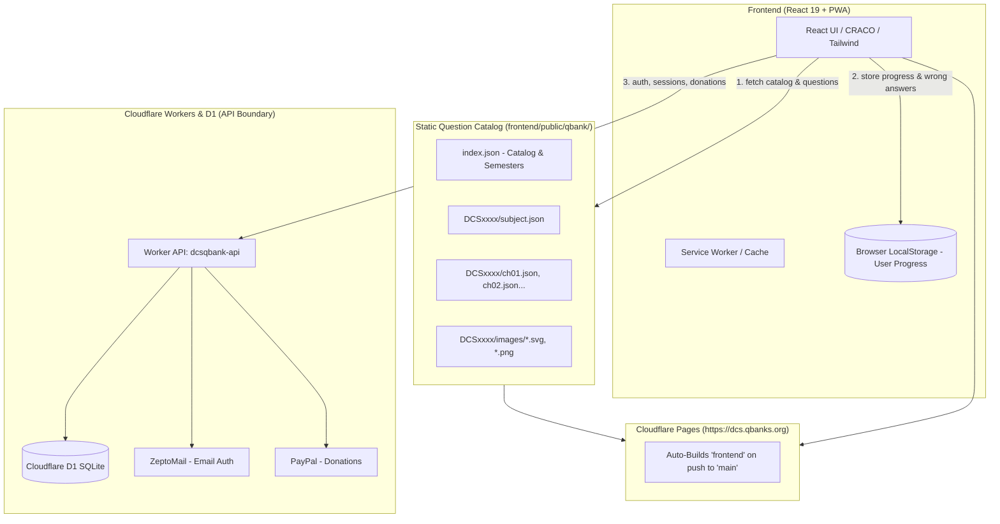
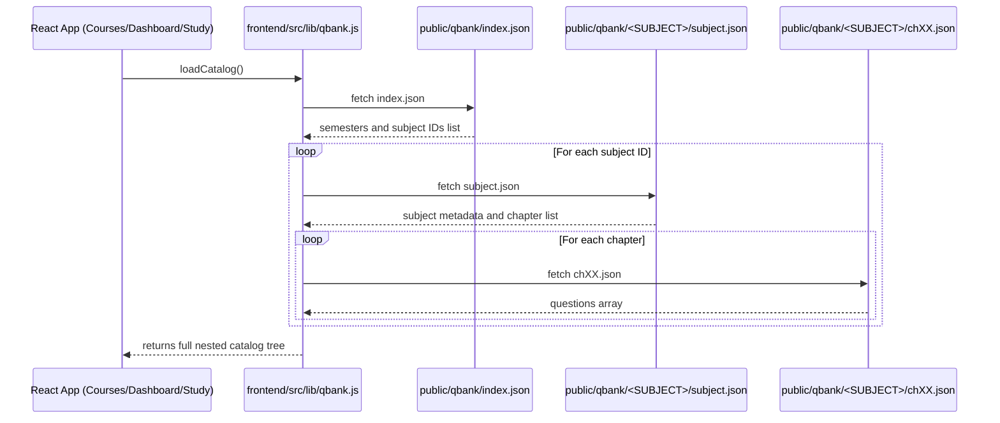

# DCSQbank: Content Authoring & Deployment Guide

This guide is a complete, step-by-step operational manual for maintaining and expanding **DCSQbank** (currently published at [https://dcs.qbanks.org](https://dcs.qbanks.org)). It explains how the project works, how content automatically populates the frontend, and how to create, validate, and publish questions, images, chapters, and subjects.

---

## Table of Contents

1. [Project Deep Dive & Architecture](#1-project-deep-dive--architecture)
2. [How the Frontend Auto-Populates Content](#2-how-the-frontend-auto-populates-content)
3. [Content Directory Hierarchy](#3-content-directory-hierarchy)
4. [Step-by-Step: Adding Questions](#4-step-by-step-adding-questions)
5. [Step-by-Step: Adding Images](#5-step-by-step-adding-images)
6. [Step-by-Step: Adding Modules / Chapters](#6-step-by-step-adding-modules--chapters)
7. [Step-by-Step: Adding New Subjects](#7-step-by-step-adding-new-subjects)
8. [Automated Content Import (Bulk Questions)](#8-automated-content-import-bulk-questions)
9. [Pre-Deployment Validation & Local Testing](#9-pre-deployment-validation--local-testing)
10. [Step-by-Step: Deploying to dcs.qbanks.org](#10-step-by-step-deploying-to-dcsqbanksorg)
11. [Troubleshooting & Common Mistakes](#11-troubleshooting--common-mistakes)

---

## 1. Project Deep Dive & Architecture

### What is DCSQbank?
**DCSQbank** is a high-performance, mobile-responsive question bank built specifically for students in Humber College’s Diagnostic Cardiac Sonography (DCS) program. It offers Study Mode (with immediate rationales and image breakdowns) and Exam Mode (timed tests with randomized option orders and diagnostic scoring).

### Architecture Overview



### Core Architectural Principles:
1. **Decoupled Static Content Model**:
   - The entire question catalog (subjects, chapters, questions, and images) lives as static JSON files and media under `frontend/public/qbank/`.
   - **No database queries or backend code edits are required to add questions, images, or subjects.**
   - Everything is compiled into static assets by `npm run build` and distributed globally via Cloudflare's CDN edge.
2. **Anonymous Browser-First Progress**:
   - Learner progress (completed questions, answers, bookmarks, flags, wrong answers) is saved in the user's browser `localStorage` (`dcs_qbank_progress_v1`), keyed by **question ID**.
   - **Rule**: Never change or reuse a published question ID. Renumbering or modifying an ID breaks existing learner statistics and wrong-answer notebooks.
3. **PWA (Progressive Web App)**:
   - DCSQbank is installable directly from Safari/Chrome on iOS, Android, and Desktop via standard PWA service workers and manifests (`frontend/public/manifest.json`).
4. **Cloudflare Worker API Boundary**:
   - The Cloudflare Worker (`worker/src/index.js`) and D1 database (`dcsqbank-production-db`) handle user accounts, email verification (ZeptoMail), PayPal transactions, and feedback.
   - The question bank itself is delivered cleanly and rapidly via Cloudflare Pages.

---

## 2. How the Frontend Auto-Populates Content

The auto-population mechanism is implemented in `frontend/src/lib/qbank.js`:



### Automatic UI Updates:
- **Total Question Counters**: Calculated dynamically from loaded questions (`subj.chapters.reduce(...)`).
- **Dashboard & Semester Tabs**: Automatically grouped by semester IDs (`sem1`, `sem2`, etc.) defined in `index.json`.
- **Chapter Cards & Progress Bars**: Drawn dynamically from `subject.json`.
- **Exam Mode Pool**: Pulls all questions across all chapters in the selected subject automatically.
- **Section Filters**: Extracted on the fly from the `tags` array on each question object.
- **Icons & Theming**: If you add a new subject without configuring custom colors or icons, the app safely defaults to `DEFAULT_THEME` and the `BookOpen` icon.

---

## 3. Content Directory Hierarchy

All question bank content resides in `frontend/public/qbank/`:

```text
frontend/public/qbank/
├── index.json                  <-- Master catalog: semesters & list of subjects
├── README.md
├── DCS5000/                    <-- Subject folder (matches subject ID exactly)
│   ├── subject.json            <-- Subject metadata & registered chapters
│   ├── ch01.json               <-- Chapter 1 questions
│   ├── ch02.json               <-- Chapter 2 questions
│   ├── ...
│   └── images/                 <-- All images used by this subject's questions
│       ├── a4c-schematic.svg
│       └── plax-measurement.png
├── DCS5002/
├── DCS5004/
└── IPE101/
```

---

## 4. Step-by-Step: Adding Questions

### The Question JSON Contract

Each question inside `chXX.json` must adhere to this JSON format:

```json
{
  "id": "DCS5000-ch01-q005",
  "stem": "Which view provides the most accurate alignment for Continuous-Wave Doppler interrogation of aortic stenosis?",
  "image": null,
  "options": [
    "Subcostal 4-chamber view",
    "Parasternal short-axis view at the aortic valve level",
    "Apical 5-chamber or apical 3-chamber view",
    "Suprasternal notch view"
  ],
  "answer": 2,
  "explanation": "Apical 5-chamber and apical 3-chamber (apical long-axis) views align the ultrasound beam nearly parallel (0 degrees) to the left ventricular outflow tract and aortic valve jet, preventing underestimation of peak velocities.\n\nNon-parallel Doppler angles lead to cosine error and underestimate the true maximum gradient.",
  "explanationImage": null,
  "tags": ["Doppler", "Valvular Assessment"],
  "reference": "ASE Guidelines for the Echocardiographic Assessment of Aortic Valve Stenosis"
}
```

### Field Specifications

| Field | Required? | Rules & Requirements |
|---|:---:|---|
| `id` | **Yes** | Unique across the entire question bank. Convention: `<SUBJECT>-<CHAPTER>-q<NUMBER>` (e.g. `DCS5000-ch01-q005`). **Never change a published ID.** |
| `stem` | **Yes** | Non-empty question text. Markdown supported. Avoid ambiguous phrasing. |
| `image` | No | `null` or a web-relative path starting with `/qbank/<SUBJECT>/images/<filename>`. |
| `options` | **Yes** | Array containing between **2 and 6 non-empty strings**. No duplicate choices allowed. |
| `answer` | **Yes** | **Zero-based integer** index pointing to the correct option: <br>• `0` = Option A <br>• `1` = Option B <br>• `2` = Option C <br>• `3` = Option D |
| `explanation` | **Yes** | Non-empty string explaining *why* the answer is correct and why other choices are wrong. |
| `explanationImage`| No | `null` or a path to an auxiliary diagram displayed alongside the explanation. |
| `tags` | Recommended | Array of strings (e.g., `["Doppler", "Hemodynamics"]`). The **first tag** is used by the Study Mode section filter bar. |
| `reference` | Recommended | Citation, textbook chapter, or clinical guideline reference. |

### How to Add a Question Manually:
1. Open the target chapter JSON file, e.g., `frontend/public/qbank/DCS5000/ch01.json`.
2. Inspect the last question object to determine the next question number (e.g. if `q004` exists, use `q005`).
3. Add a comma `,` after the previous question object and paste the new question object into the `"questions": [...]` array.
4. Verify the zero-based `"answer"` matches your intended option.
5. Save the file.

---

## 5. Step-by-Step: Adding Images

DCSQbank supports diagrams, anatomical sketches, and ultrasound scan captures.

### 1. Place the Image File in the Subject Folder
Place your image file in:
```text
frontend/public/qbank/<SUBJECT_CODE>/images/<filename>
```
*Example:* `frontend/public/qbank/DCS5000/images/plax-anatomy.png`

### 2. Supported Formats & Best Practices
- **SVG (`.svg`)**: Preferred for diagrams, schematics, and flowcharts (crisp at all screen sizes, smallest file size).
- **PNG (`.png`) / WebP (`.webp`)**: Preferred for echocardiography scans, M-mode tracings, Doppler spectral images, and photos.
- **File size**: Keep images under 500 KB whenever possible for fast mobile loading.
- **Naming**: Use lowercase, hyphen-separated names without spaces (e.g., `rv-inflow-tract.png`).

### 3. Reference the Image in Question JSON
Update your question in `chXX.json`:

```json
{
  "id": "DCS5000-ch02-q005",
  "stem": "Identify the labeled structure indicated by arrow #1 in this parasternal long-axis view:",
  "image": "/qbank/DCS5000/images/plax-anatomy.png",
  "options": [
    "Right ventricular outflow tract",
    "Anterior mitral valve leaflet",
    "Coronary sinus",
    "Descending aorta"
  ],
  "answer": 1,
  "explanation": "Arrow #1 indicates the anterior mitral valve leaflet which has greater excursion than the posterior leaflet.",
  "explanationImage": "/qbank/DCS5000/images/plax-anatomy-labeled.png",
  "tags": ["PLAX", "Anatomy"],
  "reference": "Feigenbaum's Echocardiography, Ch. 3"
}
```

> [!IMPORTANT]
> Always verify that the path starts with `/qbank/<SUBJECT>/images/` and matches the exact case of your filename. If the path does not match a file on disk, `npm run validate:qbank` will fail.

---

## 6. Step-by-Step: Adding Modules / Chapters

When introducing a new chapter to an existing subject:

### Step 1: Create the Chapter JSON File
Create `frontend/public/qbank/<SUBJECT_CODE>/ch05.json`:

```json
{
  "chapterId": "ch05",
  "title": "Valvular Quantification & Regurgitation",
  "questions": [
    {
      "id": "DCS5000-ch05-q001",
      "stem": "What is the primary hemodynamic consequence of acute severe mitral regurgitation?",
      "image": null,
      "options": [
        "Marked left atrial dilation with normal pulmonary venous pressures",
        "Abrupt elevation of left atrial pressure leading to acute pulmonary edema",
        "Severe left ventricular concentric hypertrophy",
        "Paradoxical interventricular septal motion"
      ],
      "answer": 1,
      "explanation": "In acute severe MR, the non-compliant left atrium experiences sudden volume overload, causing high LA pressures transmitted backward into pulmonary veins.",
      "explanationImage": null,
      "tags": ["Valvular Disease", "Mitral Valve"],
      "reference": ""
    }
  ]
}
```

### Step 2: Register the Chapter in `subject.json`
Open `frontend/public/qbank/<SUBJECT_CODE>/subject.json` and append the new chapter object to the `"chapters"` array:

```json
{
  "id": "DCS5000",
  "code": "DCS 5000",
  "title": "Introduction to Echocardiography",
  "semester": "sem1",
  "chapters": [
    { "id": "ch01", "title": "History & Echo Modalities", "file": "ch01.json" },
    { "id": "ch02", "title": "Standard Windows & Views", "file": "ch02.json" },
    { "id": "ch03", "title": "Transducer Selection & Ergonomics", "file": "ch03.json" },
    { "id": "ch04", "title": "Basic Image Optimization", "file": "ch04.json" },
    { "id": "ch05", "title": "Valvular Quantification & Regurgitation", "file": "ch05.json" }
  ]
}
```

> [!NOTE]
> Ensure that `chapterId` in `ch05.json` and `title` in both files match identically.

---

## 7. Step-by-Step: Adding New Subjects

To add a completely new course or subject (e.g. `DCS6000`):

### Step 1: Register in `frontend/public/qbank/index.json`
Add your new subject code to the desired semester array:

```json
{
  "version": 1,
  "semesters": [
    {
      "id": "sem1",
      "title": "Semester 1",
      "subjects": [
        "DCS5000",
        "DCS5002",
        "DCS5003",
        "DCS5004",
        "DCS5005",
        "DCS5006",
        "IPE101"
      ]
    },
    {
      "id": "sem2",
      "title": "Semester 2",
      "subjects": [
        "DCS5500",
        "DCS5501",
        "DCS5502",
        "DCS5503",
        "DCS5504",
        "DCS5505",
        "DCS5506",
        "DCS6000"
      ]
    }
  ]
}
```

### Step 2: Create the Subject Directory Structure
In `frontend/public/qbank/`, create a new directory named exactly matching the subject code:

```powershell
mkdir frontend\public\qbank\DCS6000
mkdir frontend\public\qbank\DCS6000\images
```

### Step 3: Create `subject.json`
Create `frontend/public/qbank/DCS6000/subject.json`:

```json
{
  "id": "DCS6000",
  "code": "DCS 6000",
  "title": "Advanced Pediatric & Congenital Echocardiography",
  "semester": "sem2",
  "chapters": [
    {
      "id": "ch01",
      "title": "Segmental Approach to Congenital Heart Disease",
      "file": "ch01.json"
    }
  ]
}
```

### Step 4: Create the Initial Chapter File
Create `frontend/public/qbank/DCS6000/ch01.json` with initial questions (or an empty `"questions": []` array).

### Step 5 (Optional): Custom Subject Theme and Icon
By default, the subject will automatically adopt the default sky/teal theme and a book icon. If you want custom visual styling:

1. **Custom Icon**: Open `frontend/src/components/subjectIcons.js`:
   ```javascript
   import { Baby, ... } from "lucide-react";

   const ICONS = {
     // ...
     DCS6000: Baby,
   };
   ```
2. **Custom Color Palette**: Open `frontend/src/lib/subjectTheme.js`:
   Add a entry for `DCS6000` in `SUBJECT_THEMES` with custom Tailwind gradient and badge classes.

---

## 8. Automated Content Import (Bulk Questions)

If you have bulk multiple-choice questions with an answer key in plain text, use the included helper script:

```powershell
python scripts/import_mcq_text.py <raw_text_file> <SUBJECT_FOLDER> <chapterId> "<Chapter Title>"
```

### Raw Text Format Requirement
Save your raw text in `scripts/raw/my_questions.txt` formatted as:

```text
Section 1: Valve Mechanics

1. Which leaflet is typically involved in Barlow's disease?
A. Posterior leaflet
B. Anterior leaflet
C. Tricuspid septal leaflet
D. Non-coronary cusp

2. What is the normal mitral valve orifice area in an adult?
A. 1.0 - 1.5 cm2
B. 2.0 - 3.0 cm2
C. 4.0 - 6.0 cm2
D. 7.0 - 9.0 cm2

Answer Key
1. A: Barlow's disease characteristically features bileaflet or extensive posterior leaflet prolapse with excess tissue.
2. C: Normal adult mitral valve area ranges between 4.0 and 6.0 cm2.
```

Run:
```powershell
python scripts/import_mcq_text.py scripts/raw/my_questions.txt DCS5000 ch05 "Valvular Quantification"
```
The script will parse the stems, options, and answer key, auto-generate question IDs, assign zero-based indexes, write `ch05.json`, and register the chapter in `subject.json`.

---

## 9. Pre-Deployment Validation & Local Testing

Before publishing any change, always run the validation suite.

### Step 1: Validate QBank Data Integrity
From the repository root:
```powershell
python scripts/validate_qbank.py
```
*(Or from the `frontend/` directory: `npm run validate:qbank`)*

This verifies:
- All JSON files parse without syntax errors.
- Every subject in `index.json` has a folder and valid `subject.json`.
- Every chapter file exists and contains matching chapter IDs and titles.
- Every question has an `id`, `stem`, `options` (2–6 items), valid 0-based `answer`, and `explanation`.
- All question IDs are globally unique across all subjects.
- All referenced image paths actually exist on disk.

### Step 2: Check Content Coverage Inventory
```powershell
node scripts/qbank_inventory.js
```
*(Or: `npm run inventory:qbank`)*
Generates a markdown table displaying question counts, image usage, and coverage.

### Step 3: Run the Test Suite
From `frontend/`:
```powershell
npm test -- --watchAll=false --runInBand
```

### Step 4: Preview Locally in the Browser
From `frontend/`:
```powershell
npm start
```
1. Open [http://localhost:3000](http://localhost:3000).
2. Log in (or visit Courses/Dashboard).
3. Navigate to the subject and chapter you edited.
4. Test **Study Mode**: Verify option rendering, answer check, rationale text, and image display.
5. Test **Exam Mode**: Ensure the new questions appear and calculate scores properly.

### Step 5: Test Production Build
From `frontend/`:
```powershell
npm run build
```
Ensures that the CRACO/Webpack production build compiles without errors.

---

## 10. Step-by-Step: Deploying to dcs.qbanks.org

DCSQbank's frontend is hosted on **Cloudflare Pages** and linked directly to the GitHub repository:
- **Project**: `dcsqbank`
- **Production Domain**: `https://dcs.qbanks.org`
- **Fallback URL**: `https://dcsqbank.pages.dev`
- **Production Branch**: `main`
- **Root Directory**: `frontend`
- **Build Command**: `npm run build`
- **Output Directory**: `build`

### Standard Production Deployment Workflow

Because Cloudflare Pages is connected to GitHub, **any push or merge into the `main` branch automatically triggers a build and publishes live to `dcs.qbanks.org`**.

```powershell
# 1. Review what files you changed
git status

# 2. Stage the new/edited QBank files
git add frontend/public/qbank/

# 3. Commit your changes with a descriptive message
git commit -m "feat(content): add questions and images for DCS5000 ch05"

# 4. Push to main branch
git push origin main
```

### What Happens Next Automatically:
1. **GitHub Actions**: Triggers `.github/workflows/frontend.yml` to run automated QBank validation and test suites.
2. **Cloudflare Pages**:
   - Detects the new commit on `main`.
   - Clones the repository and runs `npm run build` in the `frontend` directory.
   - Deploys the generated `build/` bundle to Cloudflare's global edge network.
   - Updates `https://dcs.qbanks.org/` within 1–2 minutes.

### Monitoring Deployment Status:
1. Go to your [Cloudflare Dashboard](https://dash.cloudflare.com/) → **Workers & Pages** → **dcsqbank**.
2. Look at the latest build under **Deployments**.
3. Once marked with a green checkmark (`Success`), the changes are live on `https://dcs.qbanks.org/`.

### Note on PWA Service Worker & Browser Caching:
Because DCSQbank includes offline PWA capabilities:
- When a user revisits the site, the service worker updates in the background.
- Hard refresh the page (`Ctrl + F5` on Windows/Chrome or `Cmd + Shift + R` on Mac) to immediately see new static content if your browser holds a cached session.

---

## 11. Troubleshooting & Common Mistakes

| Issue | Cause | Fix |
|---|---|---|
| **`python scripts/validate_qbank.py` reports: `duplicate question id`** | Two questions share the same ID. | Ensure every ID has a unique incrementing suffix, e.g., `...-q015`, `...-q016`. |
| **`answer X is outside option range`** | Question has 4 options (`0` to `3`), but `"answer"` was set to `4` (1-based error) or a non-integer. | Convert answer to zero-based: A=0, B=1, C=2, D=3. |
| **`references missing file '/qbank/...'`** | Image filename typo, wrong extension, or wrong subject folder. | Check that the file exists in `frontend/public/qbank/<SUBJECT>/images/` and the filename case matches exactly. |
| **Chapter not appearing on Dashboard or Courses page** | Chapter file created but omitted from `subject.json`. | Add `{ "id": "chXX", "title": "...", "file": "chXX.json" }` into `subject.json`'s `chapters` array. |
| **Subject not showing in semester list** | Subject directory created but not listed in `index.json`. | Add the subject code string (e.g. `"DCS6000"`) into `frontend/public/qbank/index.json` under the appropriate semester. |
| **JSON syntax error during build/validation** | Trailing comma in JSON or unescaped double quotes inside question stem/explanation. | In JSON, trailing commas are invalid. Escape internal double quotes with `\"` or use single quotes. |
| **Cloudflare Pages build fails** | Peer dependency issues or Node version mismatch in Cloudflare settings. | Cloudflare Pages environment variable `NODE_VERSION` must be set to `20`. The committed `frontend/.npmrc` provides `legacy-peer-deps=true`. |

